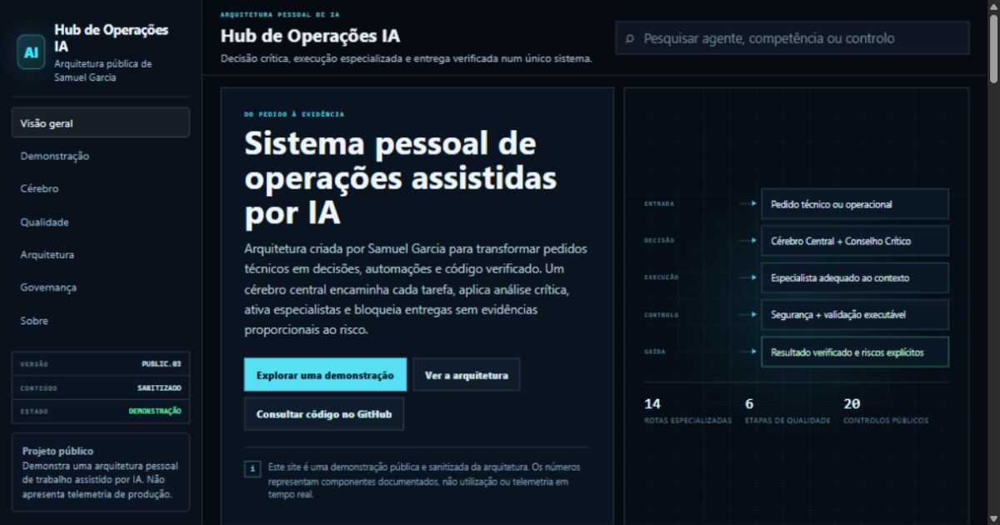

# Hub de Operações IA



Sistema pessoal de operações assistidas por IA criado por Samuel Garcia. O projeto demonstra como um cérebro central pode transformar pedidos técnicos em decisões, automações e código verificado, coordenando análise crítica, agentes especializados, segurança e um ciclo de qualidade em seis etapas.

## Ver o projeto

- Site público: <https://garcialabss.github.io/my-ai-operations-hub/>
- Repositório: <https://github.com/garcialabss/my-ai-operations-hub>

## Como funciona

```text
Pedido técnico ou operacional
→ Cérebro Central
→ Conselho Crítico
→ Especialista adequado
→ Segurança e validação
→ Resultado verificado com riscos explícitos
```

O visitante pode executar quatro demonstrações públicas:

- criar um script PowerShell seguro;
- investigar um incidente;
- avaliar um novo sistema;
- automatizar uma rotina.

Cada demonstração mostra os agentes ativados e termina com uma entrega verificável. Trata-se de uma simulação local do modelo, não de telemetria ou execução em produção.

## Capacidades apresentadas

- 14 rotas especializadas organizadas por decisão, construção, proteção e operação;
- Conselho Crítico dos 5 Conselheiros para reduzir viés de confirmação;
- ciclo Especificar → Construir → Rever → Validar → Corrigir → Entregar;
- auditoria executável de PowerShell, Python, TypeScript e configuração;
- automação, observabilidade, segurança, identidade e operações de serviço;
- inventário e governança de agentes, permissões, custo e ciclo de vida;
- pesquisa, filtros e mapa cerebral interativo;
- experiência responsiva com uma leitura vertical própria para telemóvel;
- conteúdo público sanitizado, sem credenciais ou detalhes operacionais internos.

## Finalidade

O Hub serve como projeto de portefólio e como explicação visual de uma metodologia pessoal de trabalho com IA. Demonstra competências em administração de sistemas, automação, programação, segurança, implementação tecnológica e governança de IA.

## Implementação

O site utiliza HTML, CSS e JavaScript sem dependências de execução ou backend. A aplicação é publicada pelo GitHub Pages e mantém toda a interação no navegador.

Ficheiros principais:

- `index.html` - interface, dados públicos e comportamento interativo;
- `social-preview.png` - pré-visualização para LinkedIn e redes sociais;
- `.nojekyll` - impede o processamento Jekyll no GitHub Pages.

## Publicação

O GitHub Pages publica a pasta raiz da branch configurada no repositório. Antes de cada publicação devem ser verificados:

1. sintaxe do JavaScript;
2. ausência de erros no console;
3. comportamento da demonstração;
4. layout em desktop e telemóvel;
5. ausência de segredos, caminhos locais ou nomes internos.

## Segurança

Esta é uma versão pública e sanitizada. Métricas, eventos e percursos apresentados descrevem o modelo documentado e as interações da sessão local. Não representam dados, disponibilidade ou telemetria de sistemas reais.

## Autor

**Samuel Garcia**

Administração de sistemas, automação, implementação tecnológica e operações assistidas por IA.

- GitHub: <https://github.com/garcialabss>
- LinkedIn: <https://www.linkedin.com/in/samuel-garcia-8a3347165/>
